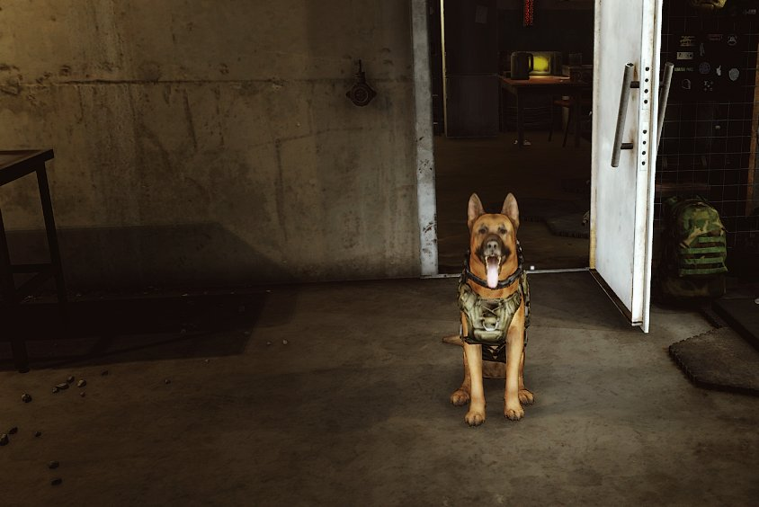
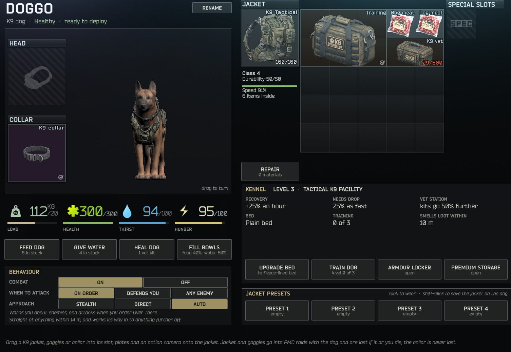
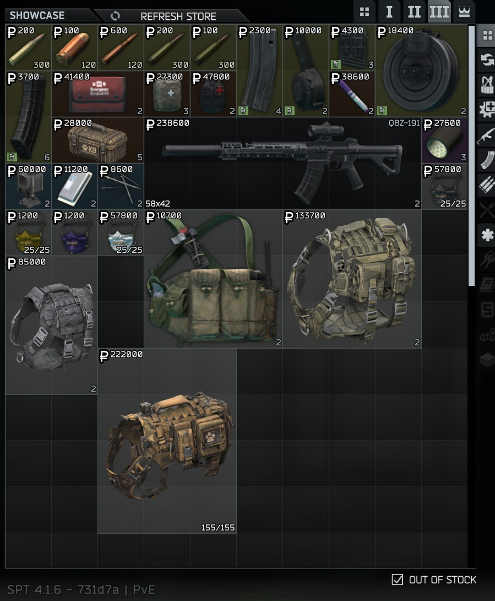
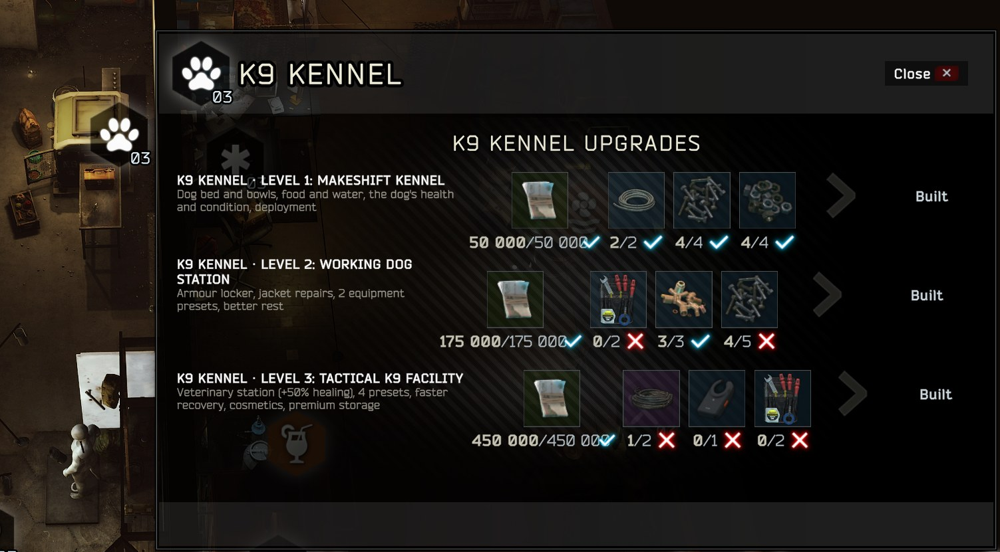
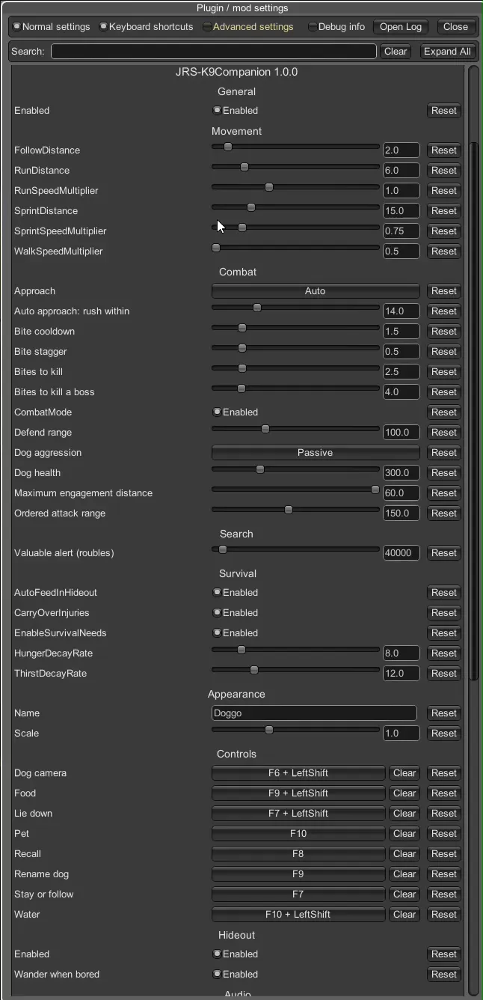

# K9 Companion

By JRS.

A K9 dog for SPT 4.1 that lives in your hideout and comes into raid with you, with its own trader (Dr. Yang), kennel
upgrades, armoured gear and a K9 questline.

| The DOG tab | Dr. Yang's shop |
| --- | --- |
|  |  |

Download the mod from its SPT Forge page or this repository's Releases. Everything about how it plays is in
[K9Companion/README.md](K9Companion/README.md).

## What's here

| Folder | What it is |
| --- | --- |
| `K9Companion` | The BepInEx plugin (client): the dog, its commands, the DOG tab and the kennel. |
| `K9Companion.Server` | The SPT server mod: Dr. Yang, the items, the questline, the kennel levels and the dog's saved data. |
| `K9Companion.Fika` | The Fika link, loaded only when Fika is installed. |

## Licence

The code is MIT (LICENSE.txt). The dog's model, animations, textures, sounds and the item models are licensed assets
and aren't covered by it.
